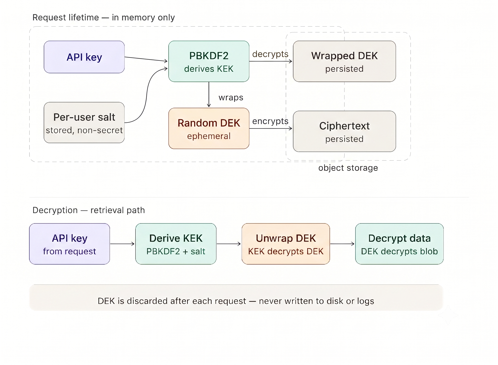

# Analysis of envelope encryption

<!-- TOC start (generated with https://github.com/derlin/bitdowntoc) -->

- [Analysis of envelope encryption](#analysis-of-envelope-encryption)
   * [1. How this document is written](#1-how-this-document-is-written)
   * [2. Technical words](#2-technical-words)
   * [3. Problem](#3-problem)
      + [3.1. Stored plaintext](#31-stored-plaintext)
      + [3.2. A key that the server stores](#32-a-key-that-the-server-stores)
      + [3.3. The API key as the cipher key](#33-the-api-key-as-the-cipher-key)
   * [4. Solution](#4-solution)
      + [4.1. Mechanism and architecture](#41-mechanism-and-architecture)
      + [4.2. Challenges](#42-challenges)
         - [Challenge C1. No name for the user](#challenge-c1-no-name-for-the-user)
         - [Challenge C2. The API key is not a cipher key](#challenge-c2-the-api-key-is-not-a-cipher-key)
         - [Challenge C3. KDF time](#challenge-c3-kdf-time)
         - [Challenge C4. Keys in memory](#challenge-c4-keys-in-memory)
         - [Challenge C5. One salt for many users](#challenge-c5-one-salt-for-many-users)
         - [Challenge C6. A change to the ciphertext](#challenge-c6-a-change-to-the-ciphertext)
         - [Challenge C7. KDF memory](#challenge-c7-kdf-memory)
         - [Challenge C8. One DEK for one API key](#challenge-c8-one-dek-for-one-api-key)
         - [Challenge C9. A fast hash](#challenge-c9-a-fast-hash)
         - [Challenge C10. Erase does not remove all copies](#challenge-c10-erase-does-not-remove-all-copies)
         - [Challenge C11. A new API key](#challenge-c11-a-new-api-key)
         - [Challenge C12. The argon2 package](#challenge-c12-the-argon2-package)
      + [4.3. Techniques](#43-techniques)
         - [Technique for challenge C1](#technique-for-challenge-c1)
         - [Technique for challenge C2](#technique-for-challenge-c2)
         - [Technique for challenge C3](#technique-for-challenge-c3)
         - [Technique for challenges C4 and C10](#technique-for-challenges-c4-and-c10)
         - [Technique for challenge C5](#technique-for-challenge-c5)
         - [Technique for challenge C6](#technique-for-challenge-c6)
         - [Technique for challenge C7](#technique-for-challenge-c7)
         - [Technique for challenge C8](#technique-for-challenge-c8)
         - [Technique for challenge C9](#technique-for-challenge-c9)
         - [Technique for challenge C11](#technique-for-challenge-c11)
         - [Technique for challenge C12](#technique-for-challenge-c12)
         - [Procedure: Change the API key](#procedure-change-the-api-key)
   * [5. Result](#5-result)
      + [5.1. Improvement](#51-improvement)
      + [5.2. Limits](#52-limits)
      + [5.3. Performance](#53-performance)

<!-- TOC end -->

## 1. How this document is written

This analysis obeys [ASD-STE100](https://www.asd-ste100.org/) Issue 9.
ASD-STE100 is Simplified Technical English.
A descriptive sentence in this analysis has a maximum of 25 words.
A procedural sentence has a maximum of 20 words.
Each paragraph has one topic and a maximum of six sentences.
The procedure section contains the procedures.

Section 2 gives the technical nouns and the technical verbs for this subject.
Each of these words has one meaning in this analysis.
One part of the software always has the same word.

The document ["Anonymous User Storage"](README.md) gives the same design in standard English.
This analysis gives the operation, the challenges, the techniques, and the results.

## 2. Technical words

The technical nouns for this analysis are:

- envelock is the software that this analysis describes.
- An API key is the value that a user sends to the server.
- A secret is the value from which envelock calculates the KEK. The API key is the usual secret.
- A salt is a value of 32 bytes. The application stores the salt. The salt is not a secret.
- A key encryption key (KEK) is a value of 32 bytes. The KEK encrypts the DEK.
- A data encryption key (DEK) is a value of 32 bytes. The DEK encrypts the user data.
- A key derivation function (KDF) calculates the KEK from the secret and the salt.
- Ciphertext is the result when envelock encrypts data.
- Plaintext is the user data before envelock encrypts it.
- An authentication tag is a value of 16 bytes. The tag shows that the ciphertext did not change.
- An initialization vector (IV) is a value of 12 bytes.
- An algorithm is the operation that encrypts or decrypts data.
- AES-256-GCM is the algorithm that encrypts the DEK and the user data.
- Envelope encryption is the method in which a KEK encrypts a DEK and the DEK encrypts the user data.
- A cipher key is the key that encrypts the user data.
- A data unit is one part of the user data.
- A median is the middle value of a set of times.
- SHA-256 is the hash of the API key. The application stores this hash to find the record.
- A user is the person or the software that has the API key.
- An attacker is a person who does not have the API key and who does an operation to read data.
- A server is the computer that runs the application.
- An application is the software that uses envelock.
- Memory is storage in the server during a request.
- A request is one operation in which the user sends the API key.
- A database is the storage for the hash, the salt, the encrypted DEK, and the ciphertext.
- A password is a secret that a person makes. A password can have a small number of possible values.
- A GPU is a processor that calculates many values at the same time.
- A package is software that the application installs for one KDF.
- Forward secrecy is the condition in which a current API key cannot decrypt old data.
- A method is a way to store or to encrypt the user data.
- A challenge is a difficulty of the envelope method.
- A technique is an operation of envelock that is applicable to a challenge.
- A limit is a condition that the method does not remove.
- A defect is a condition that makes a method not correct for the task.
- An error is a stop condition that envelock gives to the application.

The technical verbs for this analysis are:

- The verb encrypt makes ciphertext from plaintext with a key.
- The verb decrypt makes plaintext from ciphertext with a key.
- The verb store writes data into the database.
- The verb erase writes 0 into each byte of a key in memory.
- The verb install puts a package on the server.
- The verb load prepares a package in the server.

## 3. Problem

Agent software must store data for each user.
This data can contain conversation data.
This data can also contain results from tools.
A later request can use this data.

A usual server keeps a name for each user.
The server connects the stored data to that name.
Thus, the server can find the data for one user.

Some servers do not keep a name for the user.
The API key is the value that the user sends.
The API key of one user must not decrypt the data of a different user.
The server must not store a key that can decrypt the data without the API key.

### 3.1. Stored plaintext

The application can store the plaintext.
A person who can read the database can then read the data of every user.
The data of one user is not isolated from the data of a different user.

### 3.2. A key that the server stores

The application can encrypt the data with a key that the server stores.
A person who reads the database cannot decrypt the data without that key.
But the server must store a key for each user, or one key for all users.
That record connects a user to a key.
The server can decrypt the data of every user.
An attacker who can operate the application can also decrypt that data.

### 3.3. The API key as the cipher key

The application can use the API key as the key that encrypts the data.
This method has three defects:

- An API key that a person makes can have a small number of possible values.
- The application uses the same value to find the user and to encrypt the data.
- A new API key cannot decrypt the stored data.

## 4. Solution

### 4.1. Mechanism and architecture

envelock uses envelope encryption.
A DEK encrypts the user data.
A KEK encrypts the DEK.
The KDF calculates the KEK from the API key and the salt.
The server stores the salt and the encrypted DEK.
The server does not store the API key, the KEK, or the DEK.

envelock makes the DEK as 32 bytes.
An attacker cannot calculate these bytes before envelock makes them.
The DEK is not calculated from the API key.
Thus, the application can encrypt the DEK again with a new KEK.
The ciphertext of the user data can stay the same.

When the application makes a new API key, envelock does these steps:

1. envelock makes an API key and the SHA-256 hash of that key.
2. envelock makes a salt.
3. envelock calculates the KEK from the API key and the salt.
4. envelock makes a DEK.
5. envelock encrypts the DEK with the KEK and with AES-256-GCM.
6. envelock erases the KEK and the DEK.
7. envelock gives the salt and the encrypted DEK to the application.

The application stores the hash, the salt, and the encrypted DEK.
The application gives the API key to the user one time.
The application does not store the API key.

When the user sends the API key, the application and envelock do these steps:

1. The application calculates the SHA-256 hash and finds the record.
2. envelock calculates the KEK from the API key and the salt.
3. envelock decrypts the DEK with the KEK.
4. envelock erases the KEK.
5. The application encrypts or decrypts the user data with the DEK.
6. The application erases the DEK.

If the authentication tag does not agree, decrypt does not give the DEK.
envelock erases the KEK also when decrypt fails.

AES-256-GCM makes an IV and an authentication tag for each encrypt operation.
The IV has a length of 12 bytes.
The authentication tag has a length of 16 bytes.
decrypt gives an error if the tag does not agree with the ciphertext.
A wrong key causes this error.
A changed ciphertext causes this error.

envelock has three parts:

1. EnvelopeCore does the key operations and the AES-256-GCM operations. EnvelopeCore does not use NestJS.
2. One KDF calculates the KEK. The application sets this KDF.
3. A NestJS module can give the same core to a NestJS application. This module is not necessary.

envelock has three KDFs.
PBKDF2 does 600000 iterations of HMAC-SHA256.
PBKDF2 uses a small quantity of memory.

The scrypt value N is 16384.
The scrypt value r is 8.
The scrypt value p is 1.
scrypt uses 16 MiB when it calculates the KEK.
The maximum memory for this scrypt call is 32 MiB.

Argon2id uses 64 MiB and 3 iterations.
Argon2id uses one processor when it calculates the KEK.
envelock loads the argon2 package when the application uses Argon2id.
If the application does not have this package, the KDF gives an error.
The error tells the application to install the package argon2.

The figure shows the operation for one request.
The figure shows PBKDF2 as the KDF.
envelock can use a different KDF.
The DEK stays in memory during the request.
The application does not store the DEK.

### 4.2. Challenges

#### Challenge C1. No name for the user

The server does not keep a name for the user.
The API key is the value that the user sends.
The server must still make the data of each user isolated.
The server must do this with no stored KEK.

#### Challenge C2. The API key is not a cipher key

An API key is for the user to send.
An API key is not made as an AES-256-GCM key.
If the API key is the cipher key, a new API key cannot decrypt the old data.
The application then has no operation that can read that data.

#### Challenge C3. KDF time

A fast KDF lets an attacker do many tests of possible secrets.
A KDF that is not fast makes each request use more time.
A password and an API key of 32 bytes do not use the same KDF.
A GPU can do many tests of a fast KDF at the same time.

#### Challenge C4. Keys in memory

During a request, the API key, the KEK, and the DEK are in memory.
An attacker who can read that memory can decrypt the user data.
envelock cannot prevent this attack.

#### Challenge C5. One salt for many users

If many users have the same salt, an attacker can prepare one set of calculated results.
The attacker can then use that set for all of those users.

#### Challenge C6. A change to the ciphertext

A person can change the ciphertext in the database.
A wrong KEK must not give plaintext.
decrypt must not give plaintext for a changed ciphertext.

#### Challenge C7. KDF memory

Argon2id uses 64 MiB each time it calculates the KEK.
Many requests at the same time use a large quantity of memory.
A small server does not have sufficient memory for that quantity.

#### Challenge C8. One DEK for one API key

The usual operation makes one DEK for each API key.
That DEK can decrypt all data for that API key.
If an attacker gets the DEK, the attacker can read all of that data.

#### Challenge C9. A fast hash

The application stores a SHA-256 hash of the API key.
An attacker who gets the hash can do many tests of possible secrets.
The KDF does not make these tests use more time.
This is a challenge when the secret is a password.

#### Challenge C10. Erase does not remove all copies

envelock puts 0 into each byte of the keys that it has.
Other copies can stay in Node.js.
Other copies can also stay in the KDF package.
envelock cannot erase those copies.

#### Challenge C11. A new API key

A change to a new API key must use the old API key.
The hash of the old API key is not sufficient.
envelock has no operation that does all of the steps.
The application must do the steps.

#### Challenge C12. The argon2 package

The package argon2 is necessary for Argon2id.
Applications that use PBKDF2 do not use this package for the KDF.
If the package is always necessary, those applications must install it.
That package is not necessary for PBKDF2 or for scrypt.

### 4.3. Techniques

#### Technique for challenge C1

This technique is applicable to challenge C1.
envelock makes a different salt for each API key.
envelock calculates the KEK when the user sends the API key.
The server does not store the KEK.
Thus, the server cannot decrypt the data if the user does not send the API key.
The API key of one user gives a KEK that cannot decrypt the DEK of a different user.

#### Technique for challenge C2

This technique is applicable to challenge C2.
The DEK encrypts the user data.
The KEK encrypts the DEK.
A new API key makes a new KEK.
The application encrypts the same DEK with that KEK.
The ciphertext of the user data stays the same.

#### Technique for challenge C3

This technique is applicable to challenge C3.
The application sets the KDF.
PBKDF2 with 600000 iterations is the correct KDF for an API key that envelock makes.
That API key has 32 bytes from the Node.js cryptographic generator.
That length is 256 bits.
A password must use scrypt or Argon2id.

PBKDF2 uses a small quantity of memory.
A GPU can do many PBKDF2 tests at the same time.
scrypt and Argon2id use a large quantity of memory.
A GPU then cannot do the same number of tests at the same time.
Thus, PBKDF2 is not the correct KDF for a password.

#### Technique for challenges C4 and C10

This technique is applicable to challenges C4 and C10.
`generateKeyMaterial` erases the KEK and the DEK before it gives the salt and the encrypted DEK.
`resolveDataKey` erases the KEK after it decrypts the DEK.
If decrypt fails, `resolveDataKey` also erases the KEK.
The application must erase the DEK after it encrypts or decrypts the user data.
This technique does not erase copies in Node.js or in the KDF package.

#### Technique for challenge C5

This technique is applicable to challenge C5.
envelock makes a new salt of 32 bytes for each API key.
The salt is different for each user.
An attacker cannot use one set of calculated results for all users.

#### Technique for challenge C6

This technique is applicable to challenge C6.
envelock uses AES-256-GCM.
Each encrypt operation makes a new IV and an authentication tag.
decrypt gives an error if the tag does not agree.
The error is the same for a wrong key and for a changed ciphertext.
Thus, the error does not tell the attacker the condition that occurred.

#### Technique for challenge C7

This technique is applicable to challenge C7.
The application sets the memory values of the KDF.
An API key that envelock makes can use PBKDF2.
PBKDF2 does not keep 64 MiB for each request.
For Argon2id, the application must set a memory quantity that the server can give.
The server must give that quantity to the requests at the same time.

#### Technique for challenge C8

This technique is applicable to challenge C8.
The usual operation uses one DEK for each API key.
The application can make a different DEK for each data unit.
`generateDEK` and `encryptDEK` do this operation.
One DEK then cannot decrypt a different data unit.
The application stores one encrypted DEK for each data unit.

#### Technique for challenge C9

This technique is applicable to challenge C9.
envelock makes the API key from 32 bytes.
An attacker cannot do a test of all possible values of this API key.
The application uses the SHA-256 hash to find the record.
The application must not store this hash for a password.
A password must use scrypt or Argon2id.

#### Technique for challenge C11

This technique is applicable to challenge C11.
The procedure that follows changes the API key.
The procedure encrypts the DEK again.
The procedure does not encrypt the user data again.

#### Technique for challenge C12

This technique is applicable to challenge C12.
envelock does not load the argon2 package for PBKDF2 or for scrypt.
envelock loads the package when Argon2id calculates a KEK.
If the package is missing, Argon2id gives an error.
The error tells the application to install argon2.

#### Procedure: Change the API key

Do these steps to change the API key:

1. Get the old API key.
2. Get the new API key.
3. Calculate the old KEK from the old API key and the stored salt.
4. Decrypt the DEK with the old KEK.
5. Erase the old KEK.
6. Calculate the new KEK from the new API key and the salt.
7. Encrypt the DEK with the new KEK.
8. Erase the new KEK and the DEK.
9. Store the encrypted DEK.

NOTE: The hash of the old API key is not sufficient.
NOTE: A new salt is possible.

The new API key can decrypt the DEK.
The old API key cannot decrypt the DEK.
The ciphertext of the user data does not change.
If the application makes a new salt, the application stores that salt.

## 5. Result

### 5.1. Improvement

The paragraphs and the table that follow compare four methods.
The four methods are plaintext storage, a server key, the API key as the cipher key, and envelope encryption.
The comparison uses the same conditions for each method.

With envelope encryption, a person who reads the database does not get plaintext.
This person gets salts, encrypted DEKs, and ciphertext.
Each test of a possible API key uses the KDF.
The server cannot decrypt the data if the user does not send the API key.
A new API key does not make new ciphertext of the user data necessary.
AES-256-GCM finds a change to the ciphertext.

| Condition | Plaintext | Server key | API key as the cipher key | Envelope encryption |
| --- | --- | --- | --- | --- |
| A person reads the database | This person can read all user data. | This person cannot decrypt the data without the server key. | This person must do tests of possible API keys. There is no KDF. | This person gets salts, encrypted DEKs, and ciphertext. Each test uses the KDF. |
| The server does not have the API key | The server can read the data. | The server can decrypt the data. | The server cannot decrypt the data if it does not store the API key. | The server cannot decrypt the data. |
| The application makes a new API key | The application can read the stored data. | The application must encrypt the data again, or it must keep the old key. | The old API key cannot decrypt the stored data. No operation can decrypt the old data. | The application encrypts the DEK again. The user ciphertext stays the same. |
| Different users | The data of one user is not isolated. | One server key can decrypt the data of all users. | One API key cannot decrypt the data of a different user. | One API key cannot decrypt the data of a different user. |
| A change to stored data | The application does not find the change. | The application finds the change if the algorithm makes an authentication tag. | The application finds the change if the algorithm makes an authentication tag. | AES-256-GCM finds the change. |
| Time for one request | There is no time for the KDF and no time to encrypt. | There is time to encrypt and no time for the KDF. | There is time to encrypt and no time for the KDF. | There is time for the KDF and time to encrypt. |

### 5.2. Limits

The KDF makes each test of a secret use more time.
The KDF does not increase the number of possible secrets.
If a secret has a small number of possible values, an attacker can find that secret.
This limit is applicable to a password and to an API key that has a small number of possible values.

If an attacker can read process memory during a request, the attacker can get the API key and the DEK.
envelock does not prevent that attack.
The erase operation does not remove this limit.

The erase operation puts 0 into each byte of the keys that envelock has.
Copies in Node.js can stay.
Copies in a KDF package can also stay.

If an attacker gets the current API key, the attacker can decrypt the stored data.
This data contains data from before an API key change, because the DEK is the same.
The API key change encrypts that DEK again.
It does not make a new DEK.
The envelope method does not have forward secrecy.

A change to a new API key must use the old API key.
The hash is not sufficient.
envelock has no operation that does all of the steps.
The application must do the procedure in section 4.3.

The usual operation uses one DEK for each API key.
If an attacker gets that DEK, the attacker can read all data for that API key.
If each data unit has a different DEK, one DEK cannot decrypt a different data unit.
The application must do that operation.
envelock does not do it in the usual operation.

The length of the ciphertext shows the length of the plaintext.
AES-256-GCM does not remove that length.

envelock does not store the database.
envelock does not do a check of the person who sends the API key.
The application must do these two tasks.

A very large number of encrypt operations with one DEK can make two equal IVs.
Two equal IVs with the same DEK are a failure of AES-256-GCM.
The usual number of operations does not cause this condition.

The same error occurs for a wrong key and for a changed ciphertext.
An operator cannot see the cause in the error.
An attacker also cannot see the cause in the error.

Each request calculates the KEK again.
envelock does not keep the KEK for a later request.
Section 5.3 gives the time to calculate the KEK.

### 5.3. Performance

The measurement used Node.js v23.11.0.
The computer was an Apple M1 Pro with 8 cores and 16 GB of memory.
The date of the measurement was 2026-10-07.
The PBKDF2 values and the scrypt values are medians of 7 operations.
The Argon2id values are medians of 5 operations.
The AES-256-GCM values are medians of 100 operations.

These times are for this computer.
A different computer will give different times.
The table has no memory value for PBKDF2.
The table has no memory value for AES-256-GCM.
Those two operations do not use 16 MiB.

| Operation | Median time | Memory |
| --- | --- | --- |
| PBKDF2 `generateKeyMaterial` | 145 ms | Much less than 16 MiB |
| PBKDF2 `resolveDataKey` | 144 ms | Much less than 16 MiB |
| scrypt `generateKeyMaterial` | 31 ms | 16 MiB |
| scrypt `resolveDataKey` | 31 ms | 16 MiB |
| Argon2id `generateKeyMaterial` | 125 ms | 64 MiB |
| Argon2id `resolveDataKey` | 126 ms | 64 MiB |
| AES-256-GCM encrypt of 1 KiB | Less than 0.01 ms | Much less than 16 MiB |
| AES-256-GCM encrypt of 1 MiB | 0.35 ms | Much less than 16 MiB |
| SHA-256 hash of the API key | 0.001 ms | Much less than 16 MiB |

On this computer, `resolveDataKey` with PBKDF2 uses 144 ms.
Encryption of 1 MiB uses 0.35 ms.
The PBKDF2 time is more than 400 times the time to encrypt 1 MiB.
Thus, the KDF uses almost all of the time for 1 MiB of data.
The KDF also uses almost all of the time when the data length is less than 1 MiB.

On this computer, scrypt uses 31 ms and 16 MiB.
Argon2id uses 125 ms and 64 MiB.
PBKDF2 uses more time than scrypt on this computer.
This result does not make PBKDF2 the correct KDF for a password.
A GPU can do many PBKDF2 tests at the same time, because PBKDF2 uses a small quantity of memory.

`generateKeyMaterial` occurs one time for each API key.
`resolveDataKey` occurs one time for each request.
AES-256-GCM occurs one time for each encrypt operation or decrypt operation on the user data.

8 Argon2id operations at the same time use 512 MiB.
The application must set the Argon2id memory for the requests that occur at the same time.
A server that does not have this memory cannot do those operations.

Plaintext storage does not use the KDF time.
A key that the server stores does not use the KDF time.
Envelope encryption calculates the KEK again on each request.
This time is necessary because the server does not store the KEK.
The AES-256-GCM time is small on this computer for data of 1 MiB or less.
